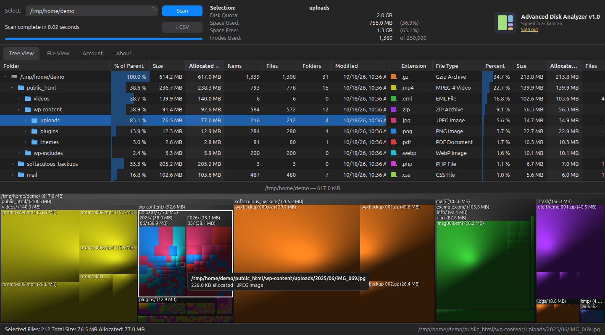
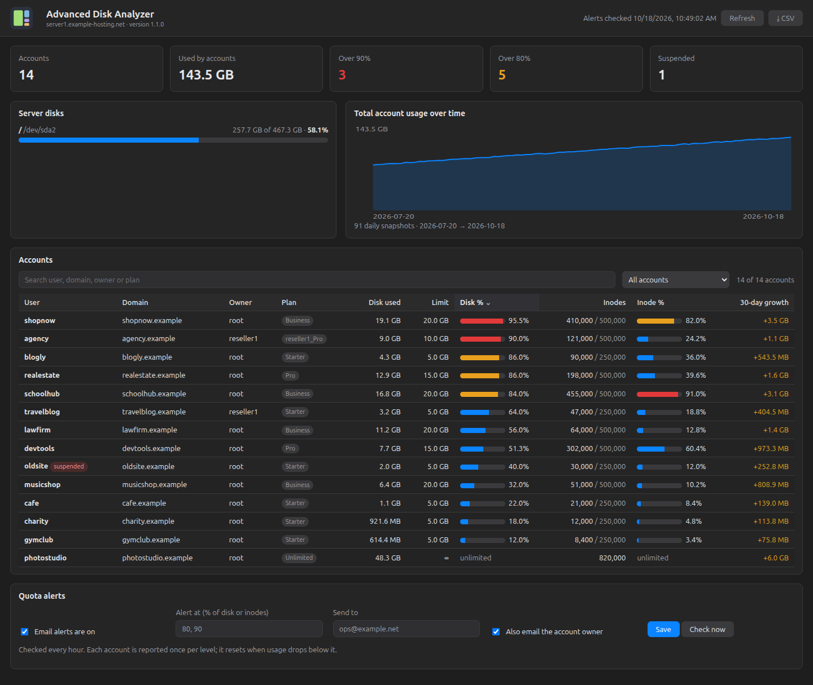
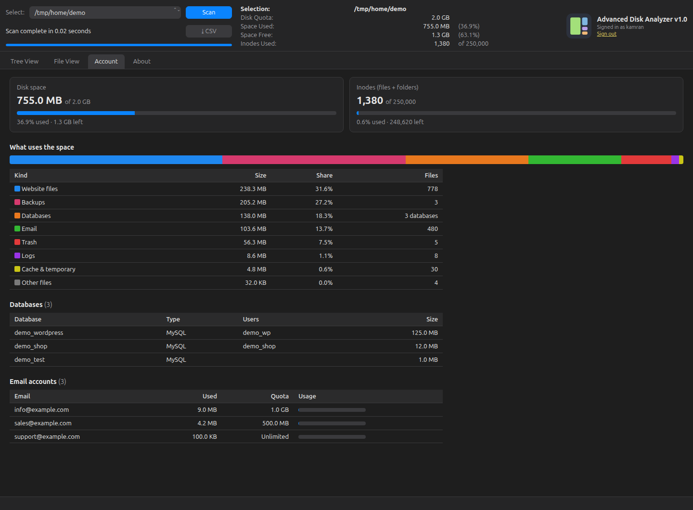
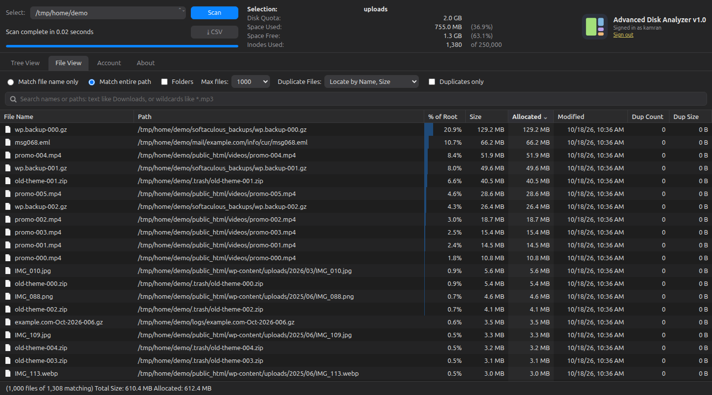
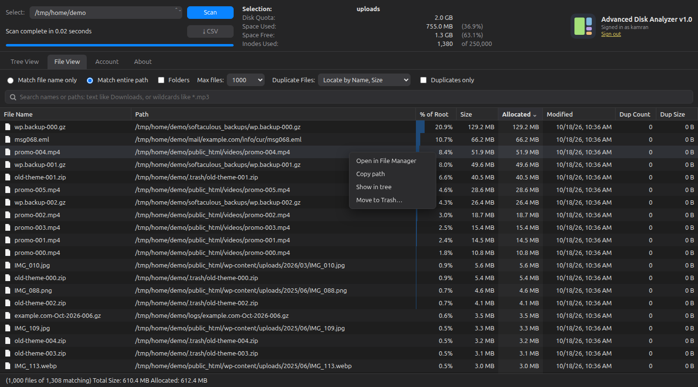
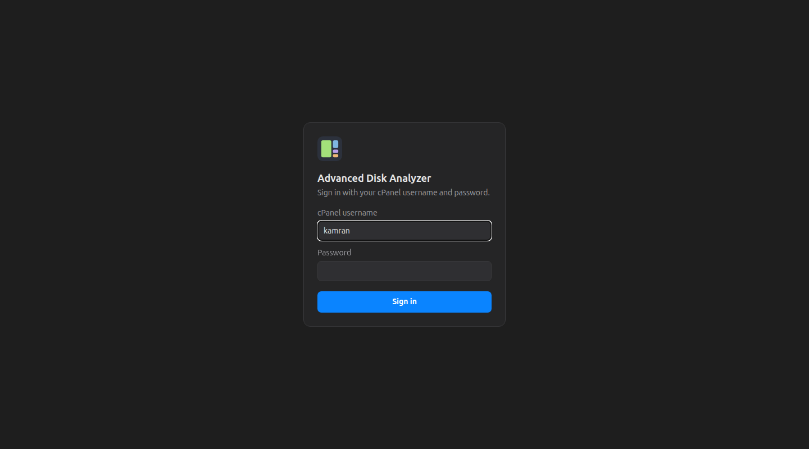
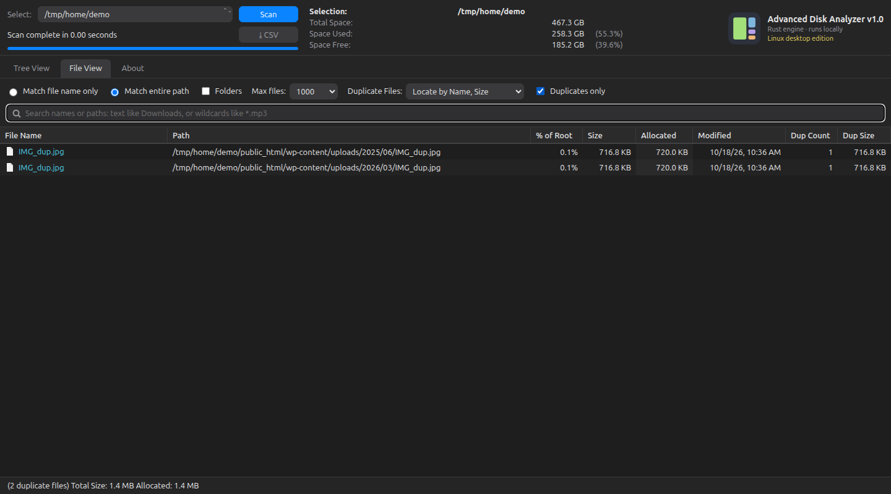

# Advanced Disk Analyzer

[](LICENSE)
[](https://github.com/kamranbhutto/disk-analyzer/releases/latest)


Free and open-source disk space analyzer for **cPanel & WHM** and **Linux**.
See exactly what is using your disk space: a folder tree with sizes, a colored
map of every file, the largest files, duplicates, and (on cPanel) databases,
email accounts, quota and inodes.

It comes in two editions that share the same interface:

| Edition | For | Built with |
|---|---|---|
| [**cPanel & WHM**](cpanel/) | Hosting customers (cPanel) and server owners (WHM), or any single cPanel account | PHP 8 + SQLite |
| [**Desktop**](desktop/) | Linux computers (Ubuntu and others) | Rust |



## Features

- **Tree View**: every folder with % of parent, size, allocated space, items,
  files, folders and modified date. Click the arrows to open folders.
- **Visual map**: every file is a box sized by the space it uses, colored by
  file type. Hover to see the path, click to find it in the tree.
- **File types**: which kinds of files (videos, backups, images…) use the most
  space. Click a type to highlight it on the map.
- **File View**: the largest files across the whole account, with search by text
  or wildcards (`*.zip`, `IMG_????.jpg`).
- **Duplicate files**: finds copies by name and size (optionally date) and shows
  how much space the extra copies waste.
- **Move to Trash**: right-click any item. It always asks first, and items can
  be restored from the Trash.
- **CSV export** of every file and folder.
- **cPanel only**: disk quota, inodes, databases, email accounts, and a
  breakdown of what the space is used for (website, email, databases, backups,
  logs, trash).
- **WHM admin dashboard**: every account on the server in one table (disk,
  inodes, % of limit, 30-day growth, owner, plan, suspended), server disks and
  a usage-over-time chart. Search, filter ("over 90%") and CSV export.
- **Quota alerts**: an hourly check emails the admin (and optionally the
  account owner) when an account reaches 80% or 90% of its disk space or inodes.
- **Fast**: the desktop edition scanned 1.4 million files (196 GB) in about 2
  seconds.

## Screenshots

**WHM admin dashboard**: all accounts, server disks, growth and quota alerts.



**Account overview (cPanel)**: quota, inodes, what uses the space, databases and email accounts.



**File View**: the largest files in the account.



**Right-click menu**: open in File Manager, copy path, move to Trash.



**Sign in (cPanel)**: with your normal cPanel username and password.



**Desktop edition**: the same views on a Linux computer.




## Quick start

### cPanel & WHM server (root): one command

```sh
curl -fsSL https://raw.githubusercontent.com/kamranbhutto/disk-analyzer/main/cpanel/plugin/get.sh | sh
```

This adds **Advanced Disk Analyzer** to every cPanel account (Tools → Files)
and to WHM (Plugins), and turns on the hourly quota alerts. Set the alert email
in WHM → Plugins → Advanced Disk Analyzer.

> **Beta:** the root/WHM install (cPanel Tools icon, WHM dashboard, alerts) is new in 1.1 and has been
> tested against a simulated cPanel/WHM API, not yet on a live WHM server. Please
> [report any problem](https://github.com/kamranbhutto/disk-analyzer/issues). The single-account
> install below is tested on a live cPanel account.

### Single cPanel account (no root needed)

1. Download `advanced-disk-analyzer.zip` from the
   [latest release](https://github.com/kamranbhutto/disk-analyzer/releases/latest).
2. cPanel → **File Manager** → `public_html` → **Upload** the zip → right-click
   → **Extract**.
3. Open `https://your-domain/disk-analyzer/` and sign in with your cPanel
   username and password.
4. Click **Scan**.

The full step-by-step guide, including manual plugin install and uninstall,
is in [cpanel/INSTALL.md](cpanel/INSTALL.md).

### Desktop (Linux)

Needs [Rust](https://rustup.rs) and Google Chrome or Chromium.

```sh
git clone https://github.com/kamranbhutto/disk-analyzer.git
cd disk-analyzer/desktop
./install.sh
```

Then open **Advanced Disk Analyzer** from your app menu (or run
`advanced-disk-analyzer`). More in [desktop/README.md](desktop/README.md).

## How sizes are counted

- **Allocated** is the space a file really takes on disk (this is what disk
  quotas count). **Size** is the file's length in bytes.
- Hard-linked files are counted once. Symbolic links are not followed.
- Scans only read folder listings and file sizes, never file contents.

## Privacy and security

- Everything runs on your own computer or your own hosting account. Nothing is
  sent anywhere else.
- cPanel edition: sign-in is checked by cPanel itself and no password is
  stored. Failed sign-ins are limited (5 per 15 minutes), forms are protected
  against cross-site requests, and scan results are kept outside `public_html`.
- Desktop edition: the server only listens on `127.0.0.1` and rejects requests
  from other websites.

## Development

```sh
# cPanel & WHM edition (needs PHP 8 with pdo_sqlite)
cd cpanel && python3 tests/test_app.py   # cPanel dashboard: 30 checks
python3 tests/test_whm.py                # WHM dashboard and alerts: 23 checks
./build.sh            # creates dist/advanced-disk-analyzer*.zip

# Desktop edition
cd desktop && cargo test
cargo run --release   # then open http://127.0.0.1:8790
```

## Contributing

Bug reports, ideas and pull requests are welcome: open an
[issue](https://github.com/kamranbhutto/disk-analyzer/issues). See
[CHANGELOG.md](CHANGELOG.md) for what changed in each version.

## License

[MIT](LICENSE): free to use, change and share, including commercially.

## Author

Kamran Bhutto
