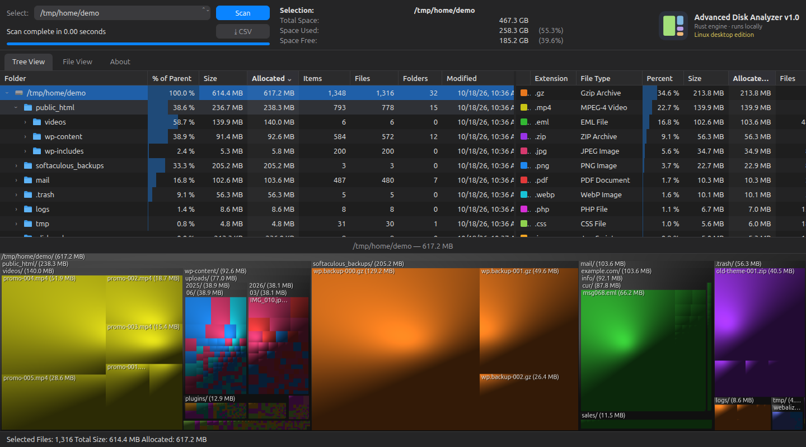

# Advanced Disk Analyzer: desktop edition (Linux)

A fast disk space analyzer for Linux. A Rust engine scans folders in parallel,
and the interface opens in its own window.



## Install

Needs [Rust](https://rustup.rs) (stable) and Google Chrome or Chromium. No sudo
needed: everything installs into your own user folders.

```sh
./install.sh
```

Then open **Advanced Disk Analyzer** from your app menu, or run
`advanced-disk-analyzer`. Run `./install.sh` again after changing the code.

To run it without installing:

```sh
./run.sh        # then open http://127.0.0.1:8790
```

## Use

1. Pick a drive or folder in **Select** and click **Scan**.
2. **Tree View**: open folders with the arrows; click a box on the map to find
   it in the tree. Keyboard: arrow keys, Enter, Delete (move to Trash).
3. **File View**: largest files, text or wildcard search (`*.iso`), duplicates.
4. Right-click any item: open it in Files, copy its path, move it to Trash
   (asks first; restore from the Trash in Files).
5. **⤓ CSV** exports everything.

## Command line

```sh
disk-analyzer --export /home/me usage.csv     # scan and write a CSV, no window
PORT=8800 disk-analyzer                       # run the server on another port
```

## Notes

- The scan stays on the selected drive and skips `/proc`, `/sys`, `/dev` and
  `/run`.
- Duplicates are matched by name and size (optionally date), not by comparing
  contents. Check before deleting a copy.
- After moving items to Trash, scan again to update the totals.
